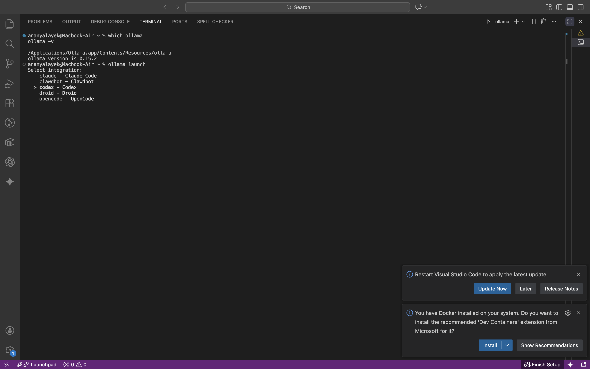
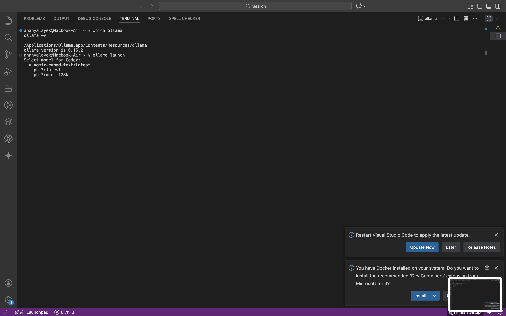
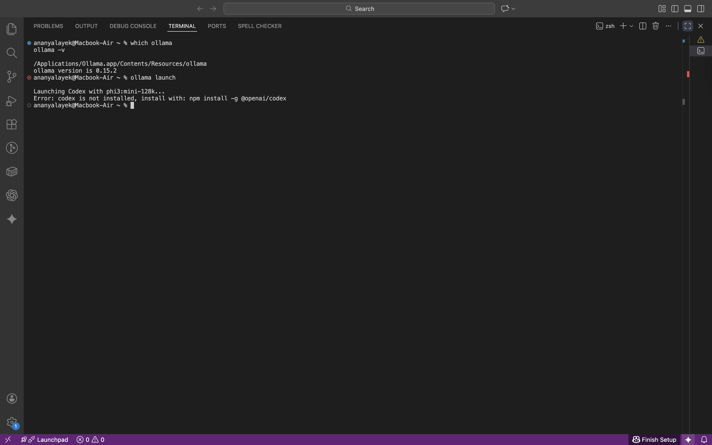
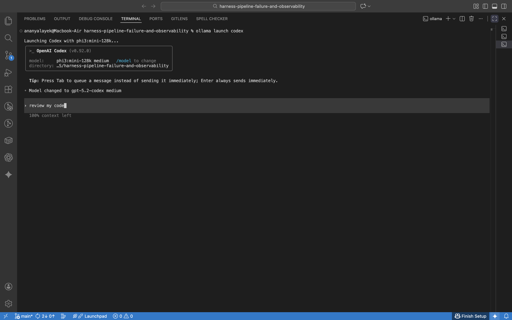

## The command, in short

`ollama launch` sets up a coding tool to use an Ollama model and starts it, with no environment variables or config files to write. It needs Ollama 0.15 or later, per the [launch announcement](https://ollama.com/blog/launch).

```bash
ollama launch                          # pick a tool, then a model, from a menu
ollama launch codex                    # start one integration directly
ollama launch claude --model qwen3.5   # choose the model as well
ollama launch droid --config           # configure it without starting it
```

The integrations listed in [Ollama's CLI docs](https://docs.ollama.com/cli), checked 2026-10-21: OpenCode, Claude Code, Codex, VS Code and Droid (Factory's coding agent). The tool has to be installed first; the launcher tells you when it is not. For coding work, the announcement recommends raising Ollama's context length to at least 64000 tokens.

## OpenCode with a local model

**Checked 20 November 2026** against Ollama's and OpenCode's documentation and OpenCode's source. Nothing in this section was run for this page, and the first run further down used Codex, so none of it is tested here.

Which OpenCode you install decides how it finds Ollama. Two release lines were current on that date:

- **OpenCode 1** (1.19.6, released 17 November 2026) is what `curl -fsSL https://opencode.ai/install | bash` and `npm install -g opencode-ai` install. The [install script](https://opencode.ai/install) says it "only installs OpenCode 1", and npm's `latest` tag pointed to 1.19.6. Its docs are at [opencode.ai/v1/docs](https://opencode.ai/v1/docs/providers).
- **OpenCode 2** (2.3.2, released 18 November 2026) has its own installer, `curl -fsSL https://opencode.ai/v2/install | bash`, named in the same script. The main [opencode.ai/docs](https://opencode.ai/docs/providers) pages describe it. See the [release list](https://github.com/anomalyco/opencode/releases).

### The short way: ollama launch

```bash
ollama launch opencode           # set OpenCode up for Ollama and start it
ollama launch opencode --config  # set it up without starting it
```

Ollama's [OpenCode page](https://docs.ollama.com/integrations/opencode) says this does not overwrite `~/.config/opencode/opencode.json`, so existing OpenCode settings still apply, and that models defined only in that file do not appear in the launch picker. `ollama launch` needs Ollama 0.15 or later.

### By hand, OpenCode 1

Add a provider to OpenCode's config, `~/.config/opencode/opencode.json`:

```json
{
  "$schema": "https://opencode.ai/config.json",
  "provider": {
    "ollama": {
      "npm": "@ai-sdk/openai-compatible",
      "name": "Ollama",
      "options": { "baseURL": "http://localhost:11434/v1" },
      "models": { "qwen3.5": { "name": "qwen3.5" } }
    }
  }
}
```

This is the shape both [Ollama's OpenCode page](https://docs.ollama.com/integrations/opencode) and [OpenCode 1's provider docs](https://opencode.ai/v1/docs/providers) show. Each key under `models` is a model name as `ollama list` shows it. Start `opencode` and pick the model with `/models`.

### OpenCode 2 finds Ollama by itself

With Ollama running on the same machine, OpenCode 2 probes `http://127.0.0.1:11434` and adds the models it finds to `/models` without any config, per its [provider docs](https://opencode.ai/docs/providers). At 2.3.2 the [source](https://github.com/anomalyco/opencode/blob/c0ad18b402eb2827fc1ee71c171b1177b3fc02d1/packages/core/src/plugin/provider/ollama.ts#L44-L90) reads Ollama's model list and each model's details, keeps the models that report the `completion` capability, and marks tool support from the `tools` capability: the same list explained in [Which Ollama models support tools](/shelf/shared-resources/which-ollama-models-support-tools/). For an Ollama server elsewhere, the docs set `providers.ollama.settings.baseURL`, ending in `/v1`. To make a model the default, set `"model": "ollama/<name>"` ([models docs](https://opencode.ai/docs/models)).

### Context length is where it breaks

Ollama's default context depends on GPU memory: 4k tokens below 24 GiB of VRAM, 32k from 24 to 48 GiB, and 256k at 48 GiB or more ([context length docs](https://docs.ollama.com/context-length)). The two projects give different numbers for what OpenCode needs:

- Ollama's OpenCode page: "a context length of 64k or higher".
- OpenCode 1's provider docs: if tool calls are not working, raise Ollama's `num_ctx`, starting around 16k to 32k.

Set it with the slider in the Ollama app's settings, or start the server with `OLLAMA_CONTEXT_LENGTH=64000 ollama serve`. `ollama ps` shows the context a loaded model is running with. A longer context needs more memory: Ollama's [launch post](https://ollama.com/blog/launch) gives about 23 GB of VRAM for `glm-4.7-flash` at 64000 tokens.

OpenCode 2 takes a model's context size from the model's own details ([source](https://github.com/anomalyco/opencode/blob/c0ad18b402eb2827fc1ee71c171b1177b3fc02d1/packages/core/src/plugin/provider/ollama.ts#L86-L88)). That is the size the model supports, which can be larger than the context your Ollama server is set to serve.

### Not tested here

A tested result would record the Ollama and OpenCode versions, the model and tag, the operating system, the exact commands and output, the date, and who ran it.

## The first run, January 2026

The rest of this page is the first run, from January 2026: what the flow looked like, the two places it stops, and what fixed them.

> **Key takeaways**
> - `ollama launch` turns model selection into a single handoff step.
> - The integration list is the contract: install the tool before you launch it.
> - A short, visible flow beats hidden config when you are new to local stacks.

This experiment is about a new entry point: `ollama launch`. Instead of wiring a tool to a model by hand, the launcher asks which integration you want and then routes the model into it. The result feels like a simple handoff layer for local AI tools.

<div id="toc-anchor"></div>
<nav class="toc" aria-label="On-page">
  <h2 class="toc-title">Contents</h2>
  <div class="toc-groups">
    <details open>
      <summary>Orientation</summary>
      <ol>
        <li><a href="#architecture-map">Architecture map</a></li>
        <li><a href="#what-happened">What happened</a></li>
        <li><a href="#the-two-gates">The two gates</a></li>
      </ol>
    </details>
    <details>
      <summary>Setup</summary>
      <ol>
        <li><a href="#setup-walkthrough">Setup walkthrough</a></li>
        <li><a href="#first-time-config">First-time config</a></li>
      </ol>
    </details>
    <details>
      <summary>Verification</summary>
      <ol>
        <li><a href="#quick-checks">Quick checks</a></li>
        <li><a href="#failure-modes">Failure modes</a></li>
        <li><a href="#what-made-the-difference">What made the difference</a></li>
        <li><a href="#what-i-would-do-next-time">What I would do next time</a></li>
      </ol>
    </details>
  </div>
</nav>

## Architecture map

`ollama launch` acts like a dispatcher. You pick a tool, then a model, and it hands the model into that tool.

<figure class="diagram">
  <svg viewBox="0 0 1200 420" role="img" aria-labelledby="ollama-launch-arch-title ollama-launch-arch-desc">
    <title id="ollama-launch-arch-title">Ollama launch handoff</title>
    <desc id="ollama-launch-arch-desc">Ollama launch selects an integration, then hands a model into the tool session.</desc>
    <rect width="1200" height="420" fill="#EFE5CF"/>
    <rect x="120" y="140" width="220" height="140" rx="16" fill="#FFFFFF" stroke="#1B1A17" stroke-width="3"/>
    <rect x="430" y="140" width="260" height="140" rx="16" fill="#FFFFFF" stroke="#1B1A17" stroke-width="3"/>
    <rect x="780" y="90" width="260" height="100" rx="16" fill="#FFFFFF" stroke="#1B1A17" stroke-width="3"/>
    <rect x="780" y="230" width="260" height="100" rx="16" fill="#FFFFFF" stroke="#1B1A17" stroke-width="3"/>
    <path d="M340 210 L430 210" stroke="#2A6F7F" stroke-width="6"/>
    <path d="M690 190 L780 140" stroke="#2A6F7F" stroke-width="6"/>
    <path d="M690 230 L780 280" stroke="#2A6F7F" stroke-width="6"/>
    <text x="230" y="215" fill="#1B1A17" font-size="23" text-anchor="middle" font-family="var(--font-mono)">Ollama</text>
    <text x="560" y="215" fill="#1B1A17" font-size="23" text-anchor="middle" font-family="var(--font-mono)">Launch menu</text>
    <text x="910" y="150" fill="#1B1A17" font-size="20" text-anchor="middle" font-family="var(--font-mono)">Tool A</text>
    <text x="910" y="290" fill="#1B1A17" font-size="20" text-anchor="middle" font-family="var(--font-mono)">Tool B</text>
  </svg>
  <figcaption>A small handoff layer: choose the tool, then the model.</figcaption>
</figure>

## What happened

The flow started with a simple command and a menu. The launcher listed available integrations (Claude, Codex, OpenCode, and others), then asked for a model. When I selected Codex without having it installed, the launcher surfaced the missing dependency clearly and told me what to install.

<figure class="diagram">
  
  <figcaption>Integration menu: the launcher presents the available tools.</figcaption>
</figure>

<details class="image-expand">
  <summary>More screenshots</summary>
  <figure class="diagram">
    
    <figcaption>Model selection: choose a local model for the selected tool.</figcaption>
  </figure>
</details>

## The two gates

The first gate is **tool installation**. If the integration is not installed, the launcher stops and tells you exactly what is missing.

The second gate is **model availability**. If the model is not local, the handoff stalls until it is pulled or selected.

## Setup walkthrough

1. Run the launcher.
2. Select an integration (Codex, OpenCode, or another tool you have installed).
3. Select a local model.
4. Start the tool session.

```bash
ollama launch
```

## First-time config

When Codex was missing, the launcher pointed to the installation command. After installing, the same launch flow worked cleanly.

```bash
npm install -g @openai/codex
```

<figure class="diagram">
  
  <figcaption>A clean failure path: missing integrations are explicit.</figcaption>
</figure>

## Quick checks

```bash
ollama launch codex
```

```bash
ollama launch opencode
```

```bash
ollama launch claude
```

<figure class="diagram">
  
  <figcaption>The handoff works once the tool is installed.</figcaption>
</figure>

## Failure modes

- Launching a tool before it is installed.
- Selecting a model that is not available locally.
- Assuming the launcher is a model manager rather than a handoff layer.

## What made the difference

The launcher compresses setup into one visible decision tree. Instead of hunting for flags and configs, you pick a tool and a model and move on.

## What I would do next time

I would pre-install the integrations I care about, then treat `ollama launch` as the default entry point for local tool sessions.

